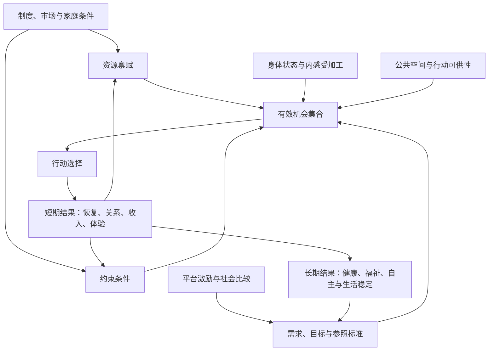

# Life Opportunity Model 01｜青年生活机会预算框架

**中文工作名：** 青年生活机会预算框架（Life Opportunity Budget Framework, LOF）  
**版本：** v0.1 · Research Hypothesis / Analytical Framework  
**状态：** 研究工作模型，不是经过整体验证的心理学定律，也不是个人生活评分器。  
**目的：** 把“身体预算、时间贫困、住房、关系、公共空间和欲望”放进一个可检验、可分层的分析框架。

---

## 0. 为什么需要这个模型

现有六机制模型告诉我们，青年生活受到哪些机制影响；五层生态模型告诉我们，影响发生在哪些环境层级。但它们还没有充分回答一个更具体的问题：

**为什么一个人明明知道某件事对自己有好处，却没有现实条件去做？**

例如：
- 知道应该运动，却每天通勤和加班到很晚；
- 想交朋友，但住处附近没有低成本、安全、可重复参加的活动；
- 想休息，却被不稳定排班、债务和工作消息持续打断；
- 想离开一份工作，却承担着高房租、家庭照护和固定支出；
- 想把房间收拾好，但住房拥挤、维修问题和居住不稳定始终存在。

这些问题不能只用“动机不足”解释。需要把**需求、资源、约束、机会和反馈**分开。

---

## 1. 核心结构：五个环节

### 1.1 需求与目标（Needs / Goals）

一个人希望获得或维持的东西：
- 生理：食物、睡眠、温度、疼痛管理、身体活动；
- 心理：自主、胜任、情绪调节；
- 关系：亲密、支持、归属、互惠；
- 生活：安全住所、收入、教育、意义、创造和休闲。

**注意：** 需求不是某个产品或身份的同义词。住房可以满足安全和隐私需要，也可能承载地位信号；运动可以满足健康、玩耍、归属或外貌目标。不同动机可能同时存在。

### 1.2 资源禀赋（Resource Endowment）

分析对象实际拥有或可调用的资源：
- 时间；
- 可支配现金、储蓄和家庭转移；
- 身体能力、睡眠和恢复状态；
- 注意力与认知资源；
- 社会支持；
- 空间、交通和公共服务可达性；
- 制度权利和信息。

这些资源不能被简单相加成一个“总能量值”。金钱不能自动兑换成可支配时间，时间也不能完全补偿身体能力或安全空间的缺失。

### 1.3 约束条件（Constraints）

限制资源如何使用的条件：
- 有酬工时、排班和工作控制权；
- 无酬家务、照护和家庭责任；
- 通勤时间、交通可靠性和空间距离；
- 房租、租约稳定、住房质量和隐私；
- 公共空间的安全、开放时间、消费门槛和无障碍；
- 平台/组织的响应要求、信息通知和绩效指标；
- 歧视、社会规范和制度资格。

**关键区分：** 约束可能是硬约束（无钱、无时间、无法进入），也可能是软约束（担心评价、信息不足、缺少熟悉感）。不能把硬约束心理化。

### 1.4 有效机会集合（Effective Opportunity Set）

某个行为是否真正可行，取决于多种最低条件是否同时满足。

例如，参加一次社区活动可能同时需要：
- 时间上能赶到；
- 费用可负担；
- 地点安全且交通可达；
- 身体状态允许；
- 活动环境对自己足够友好；
- 有足够信息知道活动存在。

因此，一个人“有兴趣”不等于“有机会”。可以将其形式化为：

`\Omega_i(t)=\{a: a\text{ 在个体 }i\text{ 的时间、资源、身体与环境约束下可行}\}`

这里的 `\Omega_i(t)` 是某个时间点的可行行动集合，不是个人能力排名。

### 1.5 行动、反馈与结果（Action / Feedback / Outcomes）

人在现实机会集合中选择行动，行动又改变未来资源和约束：
- 休息可能改善短期恢复；
- 社交可能增加支持，也可能带来额外义务；
- 消费可能满足需要，也可能增加固定支出；
- 教育投资可能提升技能，也可能占用时间并引入债务；
- 工作晋升可能增加收入，也可能减少时间控制；
- 搬家可能缩短通勤，也可能增加房租和不稳定性。

因此，不能仅看某个行动的即时收益，还要分析它如何改变未来的资源、依赖和机会。

---

## 2. 机制图：约束如何转化为生活结果

这是一张研究假说图，不是已验证的因果模型。箭头必须按具体研究拆解，不能一次性用一篇文章证明整张图。

---

## 3. 五条可检验研究假说

### H1｜工时与时间贫困：排班控制是重要调节变量

在有酬工时相近的情况下，排班不可预测、临时任务多、非工作时间响应要求高的人，可能拥有更少可计划的自由时间。

**变量：** 实际工时、排班提前量、临时变动、非工作时间工作、时间控制感、自由支配时间。  
**潜在设计：** 时间日记 + 多波问卷/EMA；控制职业、家庭结构、收入和照护责任。

### H2｜住房位置与机会集合：通勤是住房选择的中间机制之一

住房成本、位置和交通可达性可能共同影响通勤负担，进而影响运动、社交、休息和照护机会。

**变量：** 房租/收入、住房稳定性、通勤时长、交通可靠性、日常目的地可达性、自由时间。  
**潜在设计：** 纵向搬家样本、自然实验、地理空间与时间日记联结。  
**边界：** 不预设短通勤一定意味着更低住房成本或更高福祉。

### H3｜公共空间与社会联结：互动机会可能先于关系质量变化

公共空间提供低成本重复共在、共同注意和共同活动的机会，可能为信任和互惠提供条件，但空间设施本身不必然产生亲密关系。

**变量：** 空间可达、安全、开放时间、非消费性停留、六种互动模式、重复接触、信任、互惠、孤独。  
**潜在设计：** 公共空间微更新自然实验、前后对照、行为观察 + 访谈 + 纵向问卷。  
**边界：** 2023 中国青年线上横断面研究只能提供关联线索，不能验证该因果链。

### H4｜固定成本与工作选择：住房/债务负担可能压缩退出选项

较高固定支出可能增加收入依赖，使个体更难拒绝加班、转换职业或暂时休息。

**变量：** 固定支出占收入比、债务偿付、储蓄缓冲、收入波动、工作自主性、离职/转换意向。  
**潜在设计：** 家庭金融与劳动调查纵向联结；控制家庭转移、社保、资产和照护责任。  
**边界：** 不把所有消费都解释为资本主义收割；住房和医疗等必要支出也会形成刚性约束。

### H5｜社会比较与目标：参照群体可能改变主观“够用线”

个体对收入、住房、外貌、职业和生活方式的满意度，可能受到参照群体和可见反馈影响；但绝对资源与真实需求仍然重要。

**变量：** 参照群体、上行/下行比较、可见反馈、目标内化、收入、住房成本、主观满足。  
**潜在设计：** 纵向问卷、EMA、平台使用日志与自然实验。  
**边界：** 不把所有目标追求归结为地位欲；声望、归属、兴趣、责任和实际安全需求需要分开。

---

## 4. 与六机制模型的接口

| 六机制 | 在生活机会预算框架中的位置 | 核心问题 |
|---|---|---|
| M1 生理预算 | 资源禀赋/行动后的恢复反馈 | 身体状态是否允许行动与恢复？ |
| M2 内感受 | 状态信息与行动调节 | 个体能否注意并恰当地解释身体信号？ |
| M3 时间与机会 | 资源与硬约束 | 一天的时间如何被工作、照护、交通和休息占用？ |
| M4 需要与满足 | 需求/目标 | 选择满足了什么需要，又引入什么依赖？ |
| M5 地位与比较 | 参照标准与反馈 | 谁定义“够好”，比较如何改变目标？ |
| M6 具身环境 | 行动可供性 | 环境真正允许哪些行为发生？ |

## 5. 与五层生态模型的接口

| 生态层级 | 资源/约束例子 | 可行机会例子 |
|---|---|---|
| 身体与生理 | 疲劳、疼痛、睡眠、活动能力 | 是否有条件运动、休息、恢复 |
| 关系与群体 | 支持、冲突、照护义务、排斥 | 是否能安全求助、共在、互惠 |
| 物理栖息地 | 房屋质量、噪声、隐私、座椅、绿地 | 是否能安心睡觉、停留、活动 |
| 制度与资源 | 工时、收入、住房制度、公共服务 | 是否能安排时间、转换工作、获得服务 |
| 数字与商业环境 | 响应压力、推荐、消费信号、债务工具 | 是否能管理注意、减少不必要承诺 |

## 6. 方法学红线

1. 不把时间、金钱、体力、社会支持简单加成一个总分。
2. 不把“有意愿”当成“有现实机会”。
3. 不把硬约束解释成动机不足或认知偏差。
4. 不把 24 小时的主活动与互联网并行活动重复相加。
5. 不把横断面相关当作因果路径。
6. 不把一个人的选择当作在无限选项中自由最大化。
7. 不将“生活机会预算”作为个人诊断、绩效考核或道德排名工具。

## 7. 下一步验证路线

- **第一阶段：** 使用公开时间利用、住房、通勤和公共空间数据，验证变量是否可观测、口径是否一致。
- **第二阶段：** 用中国/新加坡/香港不同数据做主题模块分析，不强行合成统一指数。
- **第三阶段：** 寻找纵向、自然实验或政策变化，测试 H1–H5 的部分路径。
- **第四阶段：** 将结果交给主笔 Agent，转成有证据边界的读者版材料。

**当前判断：** 该框架的价值在于把“为什么不去做某件事”从单纯动机问题，转化为可测量的资源—约束—机会问题。它的整体解释力仍需实证检验。

## 8. 社会基础设施与支持网络：LOF v0.2 扩展

生活机会集合不仅受物理空间限制，也受“关系可以在哪里发生”的条件限制。新增社会基础设施四阶段：

1. **存在：** 场所/组织是否存在；
2. **可达：** 时间、交通、费用、安全、无障碍、开放时间和消费门槛是否允许使用；
3. **实践：** 是否实际发生停留、共在、共同注意、交流、共同活动或组织参与；
4. **关系转化：** 是否形成重复接触、熟悉感、互惠、信息流和可调用支持。

新增“支持网络拓扑”维度：家庭、朋友、伴侣、邻里、学校/工作、组织/机构、线上关系。应区分感知支持、实际收到的支持与网络结构，不将其合并成单一支持总分。

### 新增工作假说
- H6：住房空间约束可能改变住户对邻里社会基础设施的依赖。
- H7：空间配置和组织节点可能在距离之外解释参与网络。
- H8：支持来源组合可能比单一支持总分更能区分生活资源。
- H9：父母住房 tenure/资产可能影响成年子女获得住房支持的机会。
- H10：邻里凝聚可能通过邻里满意度与福祉发生联系。

这些假说均需纵向、自然实验或其他适当设计检验；不能从单一横断面样本推断因果。
