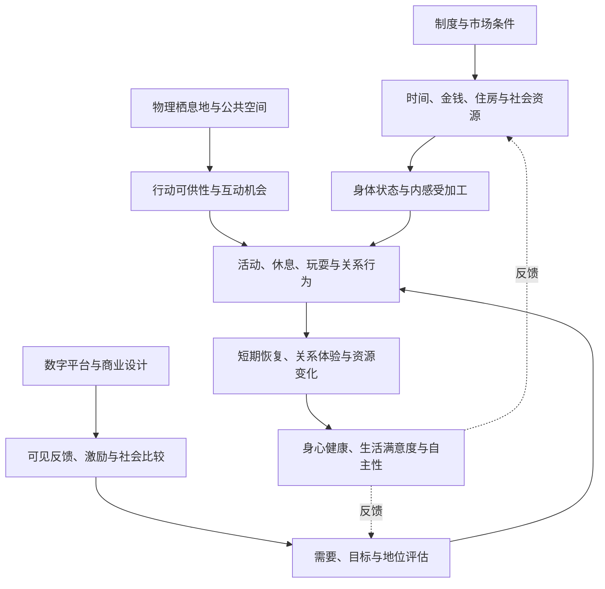

# Model Registry 01｜BEAST LIVING 六机制模型与证据接口

**状态：** Working model v0.2  
**用途：** 研究选题、变量选择、证据底卡、跨学科机制图。  
**不是：** 已验证的统一心理健康理论、个人评分器或诊断系统。

## 0. 双层结构

BEAST LIVING 使用两个互补维度：

- **五层生态层级**：身体与生理、关系与群体、物理栖息地、制度与资源、数字与商业环境。回答“影响发生在哪一层”。
- **六个机制模块**：生理预算、内感受、时间/机会、需要/满足、地位/比较、具身环境/可供性。回答“可能通过什么机制发生”。

同一个问题可以跨越多个生态层级与机制模块。例如：青年下班后不运动，可能同时涉及 M1 疲劳恢复、M3 工时/通勤、M6 街道安全和 M4 动机，而不只是 M4 动机。

---

## M1｜生理预算与动态调节

**核心对象：** TEE、REE/RMR、AEE/PAEE、睡眠、饮食、免疫、体温、恢复、疲劳。

**关键区分：**
- TEE：总日能量消耗。
- REE/RMR：静息能量消耗。
- AEE/PAEE：活动能量消耗（常需估算）。
- DIT：食物热效应。
- Energy compensation：活动变化后其他能耗/行为出现补偿。
- Constrained model：活动增加导致其他能耗成分下降，使 TEE 增量小于加和预测。

**竞争模型：** Additive / constrained / partial compensation。现有研究设计、时长、人群和测量不一致，必须并列呈现。

**常见测量：** 双标水、间接测热、加速度计、饮食记录、睡眠测量、体重/体成分。

**主要混杂/调节：** 年龄、体型、体成分、训练类型、饮食限制、能量可用性、健康状况、研究时长、自由生活/实验室条件。

**研究问题：**
- 劳动、通勤、照护、训练与睡眠如何共同构成生活负荷？
- 增加运动后，摄食、非运动活动和恢复是否发生变化？
- 什么样的运动建议对高体力工作者并不合适？

**禁止：** 把“97 W”写成统一人体功率上限；把受限能耗写成运动无效；用手环卡路里作精确代谢测量。

---

## M2｜内感受、预测与身体状态解释

**核心对象：** 身体内部信号的感知、整合、解释、注意、洞察和调节。

**关键区分：**
- Accuracy：特定任务中的客观检测表现。
- Sensibility：主观自评的身体注意/感知倾向。
- Awareness/insight：主观信心与客观表现之间的元认知对应。
- Attention：注意身体信号的方式；可适应也可不适应。
- Interpretation：如何解释信号。
- Regulation：如何根据状态调整行为。
- Propensity：在日常情境中是否、何时、如何依赖身体信号。

**常见测量：** 心跳辨别/检测、呼吸阻断、胃肠任务、温度/疼痛任务、MAIA 等自评量表、EMA。

**主要混杂/调节：** 身体通道、任务设计、药物、焦虑、疾病、先验知识、信号强度、注意风格、文化和学习经验。

**研究问题：**
- 疲劳、饥饿、困倦、疼痛如何被感知和解释？
- 什么时候“听身体”有帮助，什么时候会变成过度监测？
- 工作与平台活动是否让人忽略内部信号？

**禁止：** 把心跳计数任务等同于一般身体觉察；把“内感受越强越好”当成普遍规律；用 MAIA/手环给读者诊断。

---

## M3｜时间、资源与机会预算

**核心对象：** 有酬劳动、无酬劳动、照护、通勤、睡眠、自由支配时间、排班控制、收入和住房成本。

**关键区分：**
- 客观时间：时间日记/调查记录的活动时长。
- 时间贫困：需要定义阈值或“必要活动需求—可用时间”的关系，不存在一个适用于所有人的单一全球阈值。
- 时间控制感：对何时、如何安排时间的主观控制。
- Work-hour mismatch：实际工时与偏好工时的差距，需分别处理工时不足与过度。
- Internet use：可能与其他主活动并行，不可重复计时。

**常见测量：** 时间日记、劳动调查、通勤调查、排班数据、收入/住房支出、访谈。

**主要混杂/调节：** 性别分工、家庭结构、照护责任、就业类型、收入、地区、住房与交通、学生/就业状态、工作自主权。

**研究问题：**
- 青年真正可自由支配的时间有多少？
- 工时、通勤和照护如何共同影响运动、社交与休息？
- “提高效率”是否只让更多任务填满空出来的时间？

**禁止：** 将 18–59 岁均值写成 18–35 岁青年均值；将居民均值和参与者均值混用；把互联网使用时间与所有活动相加。

---

## M4｜需要、欲望与满足方式

**核心对象：** 生理/心理需要、满足方式、目标内化、身份信号、消费、依赖链。

**可用框架：**
- Self-Determination Theory：自主、胜任、关系需要。
- Max-Neef：需要与满足方式的区分（规范性发展框架）。
- Epicurus：自然且必要、自然但非必要、空洞欲望（哲学分类）。
- Positional goods：价值部分来自相对稀缺/排名（经济学与社会理论）。
- Hedonic adaptation：部分积极/消极变化会随时间适应，适应程度并不统一。

**分析层次：**
1. 需要：希望满足的生理、心理、关系或安全要求。
2. 满足方式：某种具体产品、关系、制度、活动或服务。
3. 信号：该选择是否向他人/群体传达身份、品味、地位或归属。
4. 依赖链：它是否引入债务、工时、照护、维护成本和制度义务。

**研究问题：**
- 同一消费同时满足真实需要与地位信号时，如何分析？
- 某个目标是自主认可、内化规范还是外部控制？
- 低欲望是自愿选择、资源不足还是抗议姿态？

**禁止：** 将哲学分类包装成生理学；把所有高价消费称为虚假欲望；把储蓄/节俭变成新的道德排名。

---

## M5｜地位、社会评价与比较

**核心对象：** Prestige、Dominance、Iconic status、Power、Wealth、Popularity、Belonging、Social comparison、Audience structure。

**关键修正：** 地位不是单一纵向排行榜。2024 年对 154 篇研究的综述提出，应区分地位类型（merit-based prestige、symbolic/iconic、power-based dominance）、功能、层级与受众结构。另一个 2024 Meta-analysis 汇总 276 个样本、56,153 人，发现地位获得与支配、能力、美德和“微政治”路径均有关，支配路径仅部分得到支持。

**常见测量：** 他人尊重/钦佩、社会影响力、受欢迎程度、领导涌现、相对收入、社会比较频率/方向、参照群体、点赞/评论反馈。

**主要混杂/调节：** 群体任务、文化、年龄、关系长度、观众数量、平台算法、阶层、性别、身份和社会安全。

**研究问题：**
- 为什么有些目标满足后仍不断升级？
- 哪些比较是挑战、哪些是威胁、哪些与个人目标无关？
- 社交平台的可见反馈怎样改变自我评价和参照群体？

**禁止：** 宣称所有人都在追逐地位；将声望与支配混为一谈；将社交媒体使用时长直接等同于心理损害。

---

## M6｜具身环境与行动可供性

**核心对象：** 环境可达性、安全、座椅/遮阴、绿地、街道连通性、隐私、非消费性停留、无障碍、行动机会。

**关键区分：**
- Affordance：特定身体在特定环境中可实现的行动可能性；不是物品的抽象“功能”。
- Accessibility：地理距离、交通时间、费用、开放时间、安全和无障碍共同构成实际可达性。
- Public-space interaction：退避、共在、共同注意、交流、共同活动、集会；不是从低到高的社交等级。
- Physical feature ≠ actual use ≠ social cohesion：设施、使用、互动和社会凝聚是不同结果。

**常见测量：** GIS/网络可达性、观察编码、空间使用、开放时间、费用、环境审计、问卷、访谈、自然实验。

**主要混杂/调节：** 年龄、性别、残障、收入、居住年限、文化规范、日夜时段、治理规则、感知安全、交通条件。

**研究问题：**
- 为什么“有公园”不等于“有地方可以不消费地待着”？
- 公共空间是否允许人选择独处、共在、偶遇和共同活动？
- 环境如何改变运动、休息和关系建立的机会？

**禁止：** 把 Gibson、Norman 和日常口语 affordance 完全混同；把公共空间设施增加直接写成孤独减少的因果。

---

## 7. 跨模块机制图（研究假说）

这张图不是已验证的统一因果模型。每条箭头需要在具体研究中明确：
- 分析单位（个人/家庭/社区/城市）；
- 时间顺序；
- 变量操作化；
- 混杂与中介；
- 研究设计与因果识别强度。

## 8. 模型交付的最小规范

每个新模型必须提交：
1. 模型类型（empirical theory / mechanism framework / heuristic / normative claim / metaphor）。
2. 原始出处和关键后续研究。
3. 核心构念和可操作化变量。
4. 可证伪预测。
5. 反向证据/竞争解释。
6. 适用人群、层级和时间尺度。
7. 对应生活问题。
8. 禁止的过度转译。
