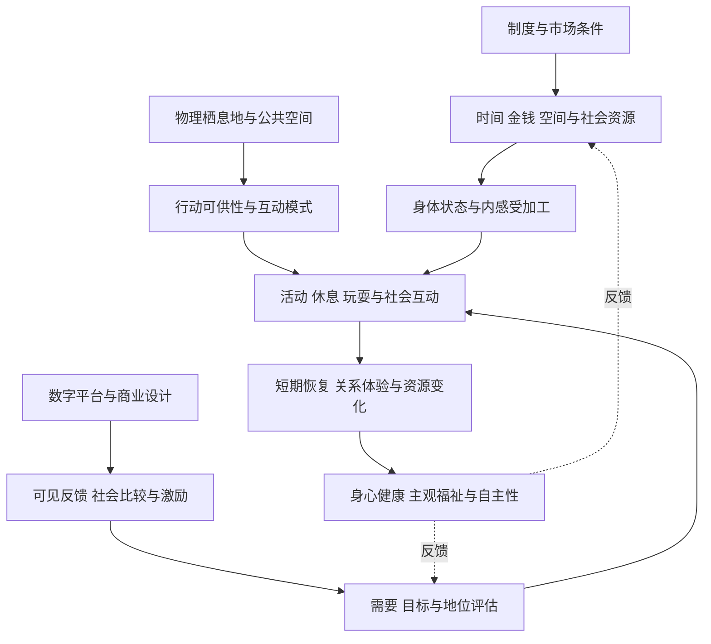

# Research & Model Synthesis 02｜争议证据、青年数据与空间—关系机制

**角色：** Research & Model Agent  
**日期：** 2026-11-15  
**状态：** RESEARCH DRAFT · 供主笔 Agent 调用，不含正文写作  
**输入：** 主笔总纲 v1.0、02C 四大核心认知专题库、Research Queue 03、公开原始研究与官方统计  
**范围声明：** 本轮是定向证据更新，不是系统综述。结论按研究设计和可核验范围限定。

---

## 0. 本轮最重要的三个修正

### 修正一：受限能耗不是已定论的“人体总电池上限”

02C 的“97 W”隐喻可以用来提示能量与时间有限，但必须把单位换算、总能耗、静息能耗、活动能耗和能量补偿拆开。更重要的是，2025–2026 年有多篇研究分别支持加和模型与受限/补偿模型，研究设计、时间尺度和测量方法并不相同。项目不得选取单一阵营作为定论。

### 修正二：内感受不是“身体感觉越敏锐越好”

2026 年系统综述与 Meta-analysis 发现，心跳计数任务表现与常见心理健康困难总体没有显著关联；心跳辨别任务、适应性内感受注意和不适应性注意的关联方向和大小不同。更重要的是，过度、僵化或威胁化地盯着身体信号，未必是适应性的身体觉察。

### 修正三：青年生活不能只靠个体行为解释

中国时间利用调查提供了全国性底座，但公开年龄分组仍是 6–17、18–59、60+，不能直接拿 18–59 岁平均数冒充 18–35 岁青年数据。与此同时，社区环境、公共空间和社会联结研究显示，邻里安全、凝聚、公共空间使用与青年孤独/疏离有关联；但大多数研究仍是观察性或横断面，因果强度有限。

---

## 1. M1 深化｜能量预算模型的争议地图

### 1.1 三种模型不能混成一句话

| 模型 | 核心预测 | 需要观察什么 |
|---|---|---|
| Additive 加和模型 | 活动能耗增加时，总能耗大体随之增加；静息能耗不必下降 | AEE、REE、TEE 的独立测量及其关系 |
| Constrained 受限模型 | 活动增加后，其他生理过程的能耗可能下降，使 TEE 增量小于加和预测 | 长期活动变化、TEE 变化、其他能耗成分变化 |
| Compensation 补偿模型 | 活动引起的 TEE 增量可能被行为或生理变化部分抵消；不一定存在固定上限 | 摄食、久坐、NEAT、REE、睡眠代谢等不同补偿路径 |

“补偿”与“受限”不是同义词：部分补偿可能存在，但不等于 TEE 达到一个普适上限。

### 1.2 关键研究对照

**Pontzer & Trexler (2026), Current Biology**

- 定量比较加和与受限模型，并整合人类运动干预和动物生态研究。
- 摘要报告：人类有氧运动干预中，TEE 平均增加约为加和模型预期增量的 30%；阻力训练的补偿较弱，合并饮食限制时补偿较强。
- 结论倾向：支持一定程度的总能耗补偿。
- 边界：这是跨研究定量综合；平均补偿比例不是个人固定值，也不能推出运动收益无效。

**Howard et al. (2025), PNAS**

- 横断面研究，覆盖从久坐者到超耐力运动者的广泛活动水平；TEE 使用双标水，活动使用加速度计，RMR 使用间接测热。
- 分析样本约 73–74 人，发现 PA 与 TEE 呈正线性关系，未观察到受限/补偿模型预测的明显曲线或 RMR 下降。
- 结论倾向：支持加和模型。
- 边界：横断面不能建立个体内因果；健康、体重稳定且能参与高活动测量的样本不代表所有人群。

**Yegian et al. (2026), Journal of Physiology**

- 两个互补分析：12 名成人完成高/低活动各 10 天的重复测量实验；另分析 268 名成人的横断面样本。
- 在 12 人实验中，活动能耗增加约 28%（约 250 kcal/day），TEE 增加约 10%（约 272 kcal/day），未发现质量校正后的 REE 下降。
- 268 人样本中，质量校正后的 REE 与 AEE 统计上独立。
- 结论倾向：支持加和模型。
- 边界：纵向实验样本非常小、周期短；268 人部分为横断面；不能据此排除其他时间尺度、其他人群或其他补偿路径。

**Flanagan et al. (2024), iScience**

- 24 周随机运动干预中，约 48% 参与者出现 exercise-related energy compensation，平均约 −308 ± 158 kcal/day。
- 研究未发现补偿组静息、睡眠或 24 小时能耗存在显著代谢适应差异。
- 边界：出现“运动能耗补偿”不等于静息代谢被压低；饮食摄入和行为变化等路径需要分别测量。

### 1.3 争议为何可能持续

1. **时间尺度不同：** 10 天的活动改变、24 周运动干预和长期自由生活观察不是同一个问题。
2. **结果变量不同：** 有的研究看 TEE 与 AEE 关系，有的看运动处方的实际能耗增量，有的看 REE 是否下降。
3. **估算方式不同：** 用 TEE 减去 REE 推算 AEE 时，测量误差可能进入差分项；双标水、间接测热、可穿戴设备各有误差结构。
4. **人群不同：** 体重稳定、健康、运动员、饮食受限者、肥胖治疗样本不可直接合并。
5. **补偿路径不同：** 摄食增加、非运动活动下降、睡眠/静息能耗变化可能发生在不同人身上。

### 1.4 对项目的可用结论

- 可以说：人体能量预算存在调节与补偿研究，活动量和总能耗之间的关系仍在争论。
- 不可以说：人体每天只有 97 W；运动会被完全抵消；运动越多越没有用；每个人都有相同的代谢上限。
- 内容转译应落在：训练、劳动、通勤、照护、睡眠、饮食和恢复需要放在同一个生活负荷账本里；不要把运动当作额外附加、与其他生活条件无关的任务。

---

## 2. M2 深化｜内感受的测量学边界

### 2.1 2026 年 Meta-analysis 的重要结果

一项 2026 年系统综述与 Meta-analysis 纳入 57 篇研究、6,652 名成人，汇总 206 个效应量：

- Heartbeat Counting Task（心跳计数任务）表现与常见心理健康困难总体没有显著关联：r = −0.042。
- Heart Rate Discrimination Task（心跳辨别任务）表现与心理健康困难存在较小负相关：r = −0.137。
- 适应性内感受注意与较少心理健康症状相关：r = −0.183。
- 不适应性内感受注意与更多心理健康症状相关：r = 0.381。
- 多数维度存在较大异质性，部分预测区间较宽；不同精神障碍的调节分析也受效应量数量限制。

这些结果不能证明内感受训练可治疗心理疾病，也不能把相关系数转化成个人风险分数。

### 2.2 研究任务不等于同一个能力

- **Heartbeat Counting Task：** 数一段时间内感到的心跳，并与真实心率比较。可能受到估算策略、先验心率知识、时间感和任务理解影响。
- **Heartbeat Discrimination/Detection Task：** 判断外部声音或刺激是否与心跳同步。任务涉及多感觉整合，不能与计数任务视为可互换。
- **Self-report scales（如 MAIA）：** 测量个体对身体信号的注意、信任、担忧或调节倾向；不是客观准确度测验。
- **Interoceptive propensity：** 日常生活中个体何时、如何依赖内部信号做判断；Murphy (2024) 建议从单次实验室准确度转向多次测量、适宜水平和现实情境中的使用倾向。

### 2.3 对项目的术语约束

优先使用：
- 内感受加工（interoceptive processing）
- 内感受准确度（interoceptive accuracy）
- 主观内感受敏感度/倾向（interoceptive sensibility）
- 内感受注意（interoceptive attention）
- 内感受洞察/元认知（interoceptive awareness/insight）
- 适应性与不适应性内感受注意

慎用“内感受失敏”。除非研究明确给出构念、测量工具和阈值，否则不要将其当作诊断名称。

### 2.4 可研究的生活问题

- 人在疲劳、饥饿、疼痛、焦虑和困倦时，如何解释内部信号？
- 身体信号被注意到后，是否被准确识别、被灾难化解释，或被工作/平台活动压过？
- “听身体的”在什么情况下有帮助，在什么情况下会演变成过度监测和健康焦虑？
- 为什么身体觉察需要与外部情境、医学测量和行为反馈结合？

---

## 3. M3 深化｜中国时间利用调查：真实时间账本的可用数据

### 3.1 调查设计

国家统计局第三次全国时间利用调查：
- 2024 年 5 月 11–31 日现场调查。
- 31 个省（区、市）及新疆生产建设兵团。
- 3.85 万户家庭、约 10.7 万名调查对象。
- 6 岁及以上常住成员。
- 每人记录一个工作日和一个周末日；15 分钟间隔。
- 调查分类扩展至 34 项活动，活动时是否使用互联网、与谁在一起等也有记录。

### 3.2 年龄口径

公开公报的主要年龄组为：
- 6–17 岁
- 18–59 岁
- 60 岁及以上

因此目前不能用公开汇总表直接声称“18–24 岁青年平均……”或“25–34 岁青年平均……”。如果要做青年研究，需要申请微观数据或使用有细年龄分组的其他调查。

### 3.3 值得进一步研究的官方统计信号

按全体居民加权平均：
- 社会交往活动：18 分钟/日；参与率 26.3%；参与者平均 1 小时 9 分。
- 运动健身：35 分钟/日；参与率 49.6%；参与者平均 1 小时 10 分。
- 家务劳动：1 小时 17 分/日；参与者平均 1 小时 59 分。
- 陪伴照料家人：30 分钟/日；参与率 28.4%；参与者平均 1 小时 46 分。
- 互联网使用：5 小时 37 分/日；参与率 92.9%。

**极其重要的口径警告：**
- “全体居民平均”与“活动参与者平均”不同。
- 互联网使用是“进行某类活动时是否使用互联网/使用时长”的统计，可能与劳动、学习、休闲等活动并行，不能与其他活动时间简单相加。
- 社会交往统计包括以交往为目的的聊天、电话、信息、聚会、仪式和志愿服务等；不等于所有关系互动，也不包括工作或学习性质的通信。
- 上述全国平均值不是青年专属数据。

### 3.4 数据获取路线

国家统计局在公开答记者问中说明，将通过微观数据实验室和与高校合作的数据开发中心，向专家学者开放经过脱敏处理的微观数据。当前应将“申请/合作获取”列为研究任务，而不是假设数据已经可公开下载。

---

## 4. M5 + M6 深化｜公共空间不是“强迫社交”，而是提供多种互动可能

### 4.1 公共空间—社会凝聚的系统综述

Qi, Mazumdar & Vasconcelos (2024) 系统综述纳入 63 项 2000–2023 年同行评审研究。潜在相关的空间条件包括：
- 可达性
- 混合土地使用
- 街道家具/座椅
- 安全感
- 视觉感受
- 地方依恋

影响会因年龄、族群、居住年限等社会人口特征而变化。作者指出，公共空间物理特征、互动过程和社会凝聚之间的链条尚未被充分整合，学科间仍有概念碎片化。

### 4.2 2026 年公共空间互动六模式

2026 年 *Journal of Environmental Psychology* 的 Meta-narrative Review 汇总 119 篇核心出版物、100 位学者，归纳六种反复出现的公共互动模式：

1. **Withdrawal 退避：** 选择独处、保持距离、暂时退出互动。
2. **Co-presence 共在：** 与他人共享空间，但不一定交谈。
3. **Co-attention 共同注意：** 一起关注同一对象或事件。
4. **Co-exchange 交流/交换：** 发生交谈、信息或物品交换。
5. **Co-action 共同活动：** 一起运动、游戏、制作或完成任务。
6. **Assembly 集会：** 形成更大规模的公共聚集。

这六类不是从低到高的社交等级，也不是每个人都应从退避走向集会。它们描述的是不同互动模式及其协调条件。

### 4.3 生态心理学的 affordance（行动可供性）

Gibson 的生态心理学把 affordance 视为环境对特定有机体提供的行动可能性。台阶对某个身体“可踏上”，对另一个身体可能不可达；同一张椅子对不同身体、不同情境的可用性也不同。

Chong & Proctor (2020) 指出，affordance 概念在不同学者和领域的使用中已经发生变化，不能把 Gibson 原始概念、Norman 的设计可供性和日常口语中的“功能”完全混为一谈。

项目应优先使用较具体的说法：
- 环境提供了哪些行动机会？
- 哪些身体能使用这些机会？
- 费用、开放时间、安全、无障碍、性别/文化规范是否限制使用？
- 这些空间是否允许独处、共在、偶遇、交流或共同活动？

### 4.4 中国青年相关研究入口

Su, Zhang & Chen (2023), *Habitat International*：
- 线上调查 637 名中国城市青年居民，覆盖 22 个省份。
- 使用路径分析和结构方程模型，讨论社区公共空间使用、社会资本、信任、互惠规范与疏离感。
- 摘要报告公共空间使用与较低疏离感相关，社会资本路径可能发挥中介作用。
- 边界：线上问卷与横断面模型不能确立因果；样本年龄定义、抽样代表性、变量量表与完整模型需全文复核。

### 4.5 青年孤独的社区/社会决定因素

2026 年一项系统综述聚焦 18–30 岁青年，纳入 13 项观察性研究：
- 更好的邻里氛围、安全感和社会凝聚与较低孤独感相关。
- 邻里失序、少数群体身份和感知歧视与较高孤独感相关。
- 社会隔离的研究更少、方法异质性更大。
- 大多数研究为横断面，不能写成“改善公园必然治愈孤独”。

---

## 5. 青年生活的整合模型 v2：从五层环境到六个机制

原有“五层生活生态模型”回答**影响发生在哪个环境层级**；六模块回答**通过什么机制发生**。本轮增加一个中间环节：**行动可供性与互动模式**。

### 5.1 双层模型

| 生态层级 | 主要机制模块 | 例子 |
|---|---|---|
| 身体与生理 | M1 能量/恢复；M2 内感受 | 疲劳、睡眠、饥饿、疼痛 |
| 关系与群体 | M4 需要/归属；M5 地位/比较 | 支持、冲突、声望、排斥 |
| 物理栖息地 | M6 可供性；M1 恢复 | 座椅、噪声、绿地、隐私 |
| 制度与资源 | M3 时间/机会；M4 需要满足 | 工时、收入、租房、照护 |
| 数字与商业环境 | M4 欲望/信号；M5 比较 | 点赞、推荐、消费、平台激励 |

### 5.2 工作机制图（研究假说，不是已验证因果链）

箭头表示待检验的机制假说。每条路径必须在具体研究中明确变量、时间顺序、混杂因素和研究设计；不能把这张图当作已经验证的单一模型。

---

## 6. 对现有条目的研究启发

| 现有条目 | 本轮应补的研究变量/机制 | 不应作出的结论 |
|---|---|---|
| 001 巢穴维护 | 空间可用性、认知卸载、租住稳定性 | 房间整洁可解决住房不安全 |
| 002 身体与移动 | AEE/TEE 模型争议、工作体力负荷、活动机会 | 运动能耗被完全抵消 |
| 003 关系与联结 | 共在、共同注意、共同活动、关系质量 | 公共空间越热闹越好 |
| 004 休息与节律 | 内感受注意、睡眠、工作侵入、时间控制感 | 身体觉察越多越健康 |
| 005 无产出玩耍 | 自主/胜任/关系需要、玩耍机会 | 玩耍一定提高智力或治疗压力 |
| 006 自然散步 | 可达性、安全、行动可供性 | 有绿地就必然改善所有人的心理健康 |
| 007 自主生活 | 位置性目标、声望/支配、外部控制 | 所有成就欲都是虚荣 |
| 008 社会缓冲 | 关系安全、适应性注意、支持类型 | 任何陪伴都能减压 |
| 009 压力适应 | 生理预算、内感受测量、恢复机会 | 可以从手环推算个人 Allostatic Load |
| 010 环境与运动 | 环境暴露、活动表现、个体差异 | 单次实验说明城市让人退化 |
| 011 住房安全 | 住房可负担、质量、稳定性、年龄样本 | 25–64 岁住房研究等同于青年研究 |
| 012 日常活动 | 时间利用、通勤、公共空间可达性 | 全国平均等于青年平均 |
| 013 社会支持 | 公共空间六模式、社区凝聚、孤独/隔离区分 | 社交媒体使用时长等于孤独 |
| 014 休闲内疚 | 时间控制、工时错配、内感受注意 | 休息困难全由功绩主义造成 |
| 015 结构性困难 | 时间/资源/机会、个人能动性与制度限制 | 个体行动无用或一切都由结构决定 |

---

## 7. 本轮可形成的新选题池（研究候选，不是正文标题）

1. **为什么你有公园，却没有地方待？** 公共空间是否允许不消费的停留、退避和共在？
2. **社交不一定要说话。** 共在、共同注意和共同活动如何成为低压力关系入口？
3. **为什么“多听身体的”不一定更好？** 适应性注意与不适应性监测的区别。
4. **运动之后，身体究竟补偿了什么？** 加和、受限与补偿模型的争议。
5. **谁拿走了你的 15 分钟？** 用中国时间利用调查看通勤、家务、照护、社交和自由时间。
6. **附近的公共空间，如何变成附近的人？** 从空间可供性到信任与互惠的中间机制。
7. **为什么低欲望不能只靠少买东西？** 住房、家庭责任、收入和社会保险如何决定节制是否自愿。
8. **孤独是一个人的问题，还是社区的结构？** 18–30 岁社区决定因素证据及其限制。

---

## 8. 下一步研究优先级

**P0**
- 将受限能耗争议写入 Claim Register，不再单向表述。
- 补充内感受 2026 Meta-analysis 与 HCT/HRT 测量批评。
- 把 2024 时间利用调查的年龄分组、参与者口径、活动重叠和微观数据访问写入数据字典。
- 为“公共空间—互动模式—社会联结”建立一张机制卡。

**P1**
- 全文复核中国青年公共空间调查的年龄定义、抽样与测量。
- 获取国家统计局微观数据访问条件，评估是否能按 18–24、25–34、35–44 岁分析。
- 对中国住房可负担性研究检查年龄范围、变量定义和内生性策略。
- 搜索新加坡、香港及东亚青年住房、时间利用、社会联结的可比数据。

**P2**
- 将六模块与五层生态模型做成变量—测量—混杂因素字典。
- 为 15 篇现有条目生成可交接的证据底卡。
- 对 02C 的创作者原创模型逐条分类：机制理论、测量框架、系统启发式、哲学规范、传播者模型或实践方法。
